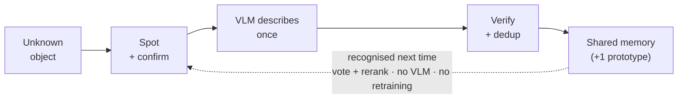

# Open-World Mission Learner

An agentic robot that **learns new objects during a mission** — with no retraining on the live path.

It starts a mission knowing few or no objects. When it sees something it doesn't recognise, it confirms the sighting over several frames, asks a vision-language model to describe it **once**, writes it to a shared vector memory, and recognises it on sight from then on — by embedding match, not by retraining a network.

> **Status:** in active development (Phase 0 → 1). Built in simulation first (sample video, then ROS 2 + Gazebo). Runs on a CPU laptop; a Kaggle GPU is used only for offline calibration and benchmarks.

---

## The loop



Every object the robot meets either **matches** something already in memory (recognised, zero cost) or is **novel** — in which case it's confirmed across frames, described once by the VLM, and stored. Recognition afterwards is a nearest-neighbour lookup plus a label vote; the expensive model never runs on a known object twice.

---

## How it works

**Perception is open-set, not closed.** An open-vocabulary detector (YOLO-World / Florence-2) proposes boxes with a broad prompt so genuinely unknown things still get localised. An *objectness* score filters junk boxes; it never decides identity.

**Memory is the classifier.** Each crop is embedded with a **frozen** CLIP/SigLIP encoder. Identity is decided by cosine distance to stored prototypes — not by a trained softmax. "Learning" a new object is literally *appending an embedding*. No gradients on the mission loop.

**The VLM runs once, gated.** A box that reads novel must survive `k` confirmation frames. On confirmation, a provisional prototype is written immediately (so re-sightings match with no model call), and a small chat-VLM is called **once** to backfill a candidate-label list + attributes (colour, material, features). The prompt is context-aware: it includes the known objects in view, and — on the robot — the object's location.

**Recognition reuses an [ADAM](https://arxiv.org/abs/2506.08968)-style path.** A re-seen object retrieves its nearest neighbours' candidate-label lists, keeps labels appearing in a majority (frequency vote), then picks the final name by cross-modal rerank: `argmax cos(image_embedding, CLIP_text(label))`. No new VLM call.

**An agent drives it.** A LangGraph planner wraps perception as tools, plans a patrol, and replans when a novel-object event fires mid-mission — investigate, learn, resume.

**On the robot, objects get a location.** The 3D pose comes from classical geometry (depth deprojection + TF2 to the `map` frame), not from the VLM. Navigation is off-the-shelf Nav2 — the learning loop is the contribution, not the controller.

---

## Two-tier recognition

| Tier | When | Mechanism | Retraining? |
|------|------|-----------|-------------|
| **1 — online** | Every mission, hot path | Zero-shot embedding memory + label vote | Never |
| **2 — offline (optional)** | Between missions | Diffusion-augmented synthetic data trains a lightweight classifier head on a **frozen** backbone | Head only, offline |

Tier 2 is optional (Phase 6). Once an object has been seen and labelled enough, its real crops seed a diffusion model (img2img / LoRA personalisation) to generate synthetic views, and a small head is trained on known + newly-graduated classes. It is **promoted to the live stack only if it beats zero-shot on a held-out set of real crops** — otherwise zero-shot stays. The synthetic→real domain gap is a real risk; the promotion gate turns it into a quantitative ship/no-ship decision.

---

## Memory: three tiers, local-first

Recognition runs every keyframe, so it never waits on a network.

- **In-memory index** (FAISS / NumPy) — `match()` always hits this. Sub-millisecond, no network.
- **Local store** (embedded Qdrant / SQLite+vectors) — survives restarts, works offline.
- **Shared Qdrant server** — the sync target. New and updated prototypes are pushed, other robots' additions pulled, on a **background thread** — never on the recognition path.

A robot recognises from whatever is in RAM right now. If another robot learned something that hasn't synced yet, this one re-learns it and dedup reconciles the two at sync time. Multi-robot shared memory is then just a second client of the same server.

Each prototype stores: `{object_id, status, candidate_labels[], canonical_label, category, attributes, world_xyz, observation_count, robot_id, first_seen, last_seen}`.

---

## Repository layout

```
.
├── perception/     # open-vocab detection, CLIP embedding, novelty scoring, describe-once
├── agent/          # LangGraph planner, tools, event-driven replanning
├── memory/         # MemoryStore: in-memory index, local store, shared-server sync
├── ros_ws/         # ROS 2 nodes, Gazebo world, sensor fusion (pixel → map pose)
├── notebooks/      # Kaggle: novelty-scorer calibration, gold labels, CLIP vs SigLIP, synthesis
├── tests/          # pytest acceptance gates (grow every phase)
└── docker-compose.yml
```

---

## Roadmap

| Phase | Focus | Acceptance gate |
|-------|-------|-----------------|
| **0** | Foundations, shared memory, test harness | Memory round-trip + CLIP sanity + sync round-trip pass |
| **1** | Open-world perception loop on video | A new object → 1 VLM call; re-sightings → 0 calls, 0 duplicates |
| **2** | Agentic planner (LangGraph) | Trace shows exactly one `describe()` per novel object |
| **3** | ROS 2 + Gazebo bridge, located detections | Stored `world_xyz` within tolerance of ground truth |
| **4** | Full integration in sim | Second patrol: 0 new VLM calls, 0 duplicates |
| **5** | Multi-robot, package, CI | Robot A learns → robot B recognises after one sync |
| **6** | *(optional)* Offline consolidation: synthetic data + trained classifier | Classifier ships only if it beats zero-shot on held-out real crops |

Each phase closes on an automated gate; CI keeps them green as the system grows.

---

## Running it (Phase 0)

> Scaffold in progress. Target workflow:

```bash
# shared vector memory
docker compose up -d qdrant

# environment
uv sync          # or: pip install -r requirements.txt

# the acceptance gates
pytest
```

**Prerequisites:** Python 3.11+, Docker. ROS 2 Jazzy + Gazebo Harmonic are needed from Phase 3 onward (Ubuntu 24.04). No GPU required for the live loop; a Kaggle T4 (or any CUDA GPU) is used for the offline notebooks.

---

## Stack

Perception: YOLO-World / YOLOE / Florence-2 · CLIP · SigLIP (`open_clip`)
Memory: FAISS + Qdrant (in-memory · local · shared server)
Agent: LangGraph · a ≥7B planner LLM (API or local via Ollama)
Robotics: ROS 2 Jazzy · Gazebo Harmonic · Nav2
Offline (optional): SD-Turbo / SDXL · Weights & Biases · a model registry
Tooling: pytest + CI · Python · PyTorch

---

## Prior work

The design builds deliberately on recent open-world and embodied-memory research, and is explicit about what is reused vs. new:

- **[ADAM](https://arxiv.org/abs/2506.08968)** (training-free open-world labelling) — the frequency-vote + cross-modal-rerank recognition path is adapted from here, but gated by novelty and run online as memory grows from empty, rather than as an offline batch over a full repository.
- **[EmbodiedLGR](https://arxiv.org/abs/2604.18271)** — an agentic LLM + semantic memory on ROS 2; closest on structure.
- **[VLM-to-TD3](https://www.mdpi.com/1424-8220/26/15/4661)** (Sensors, 2026) — the located-memory geometry (pixel + depth → map pose) is lifted from here; this project deliberately uses Nav2 instead of a trained point-goal policy, and adds novelty-driven *learning* where that work uses a fixed vocabulary.

The distinctive combination: novelty-gated, cross-frame-confirmed, single-call VLM annotation feeding a frozen-CLIP memory that any robot shares — learning new objects on the mission with no retraining on the live path.

---

## License

MIT (see `LICENSE`).
